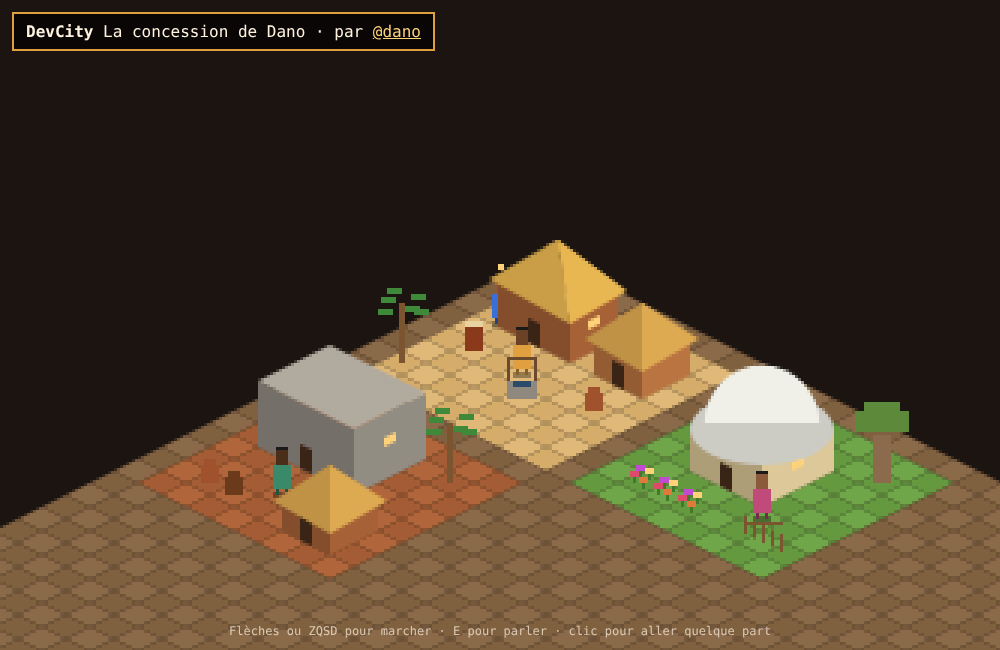

# DevCity

Une ville en pixel art isométrique, construite parcelle par parcelle par des développeurs. Chaque pull request ajoute une maison visitable.



## Construire ta parcelle en 10 minutes

1. Forke ce dépôt.
2. Crée `plots/<ton-login-github>/plot.json` (copie `plots/dano/plot.json` pour démarrer).
3. Choisis un `slot` libre (x et y entre 0 et 9) que personne n'a pris.
4. Teste en local : `npm run validate` puis `npm run dev`.
5. Ouvre une pull request. La CI vérifie ta parcelle automatiquement.

## Format d'une parcelle

Une parcelle fait 8 x 8 tuiles. Coordonnées de 0 à 7.

| Clé | Contenu |
|---|---|
| `author` | ton login GitHub (= nom du dossier) |
| `name` | nom de ta parcelle (40 caractères max) |
| `slot` | `{ "x": 0-9, "y": 0-9 }` emplacement dans la ville |
| `ground` | `sand`, `grass`, `earth`, `stone` |
| `buildings` | 4 max : `x, y, w, h, height (8-40), color, roof (thatch, flat, dome), roofColor?` |
| `decor` | 24 max : `type (palm, baobab, well, pot, fence, flowers, drum), x, y, color?` |
| `npcs` | 3 max : `name, x, y, color, skin?, dialogue (1 à 6 phrases)` |

Couleurs au format `#rrggbb`. Pas de liens dans les textes.

## Règles

- Tu ne modifies que ton dossier `plots/<ton-login>/`, et il ne contient que `plot.json`.
- Une parcelle par compte.
- Contenu respectueux : pas de haine, de contenu sexuel ni de pub. Les parcelles qui ne respectent pas ça sont retirées.
- Pas de code exécutable pour l'instant : c'est ce qui garde la ville sûre pour les visiteurs.

## Saison 1 : le village

Thème de la première saison : un village ouest-africain. Cases, marchés, puits, baobabs.

## Lancer en local

```
npm run dev
```

Pas de dépendance : le moteur est en JavaScript pur (`engine/`).
